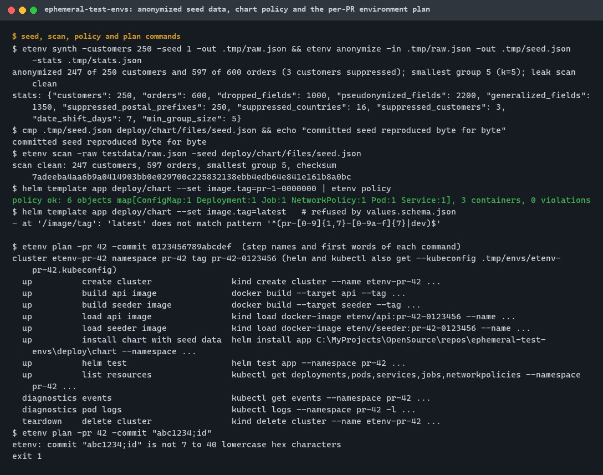
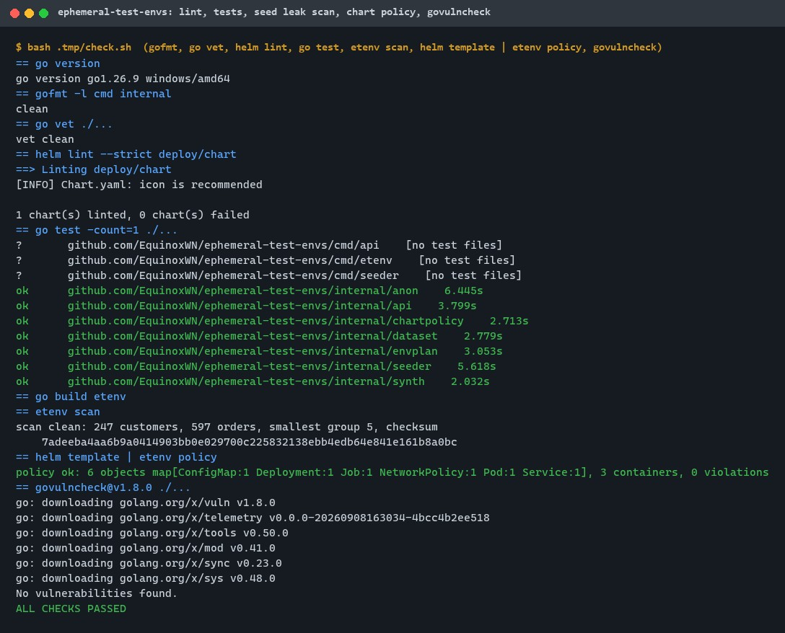
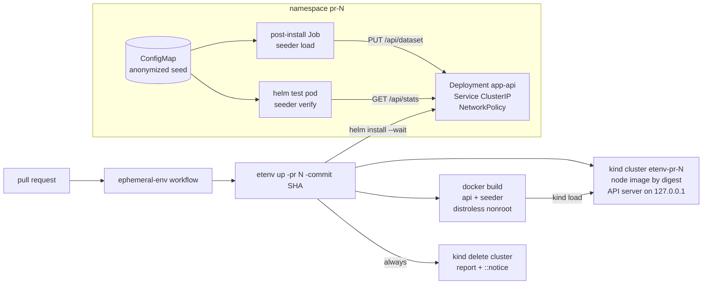
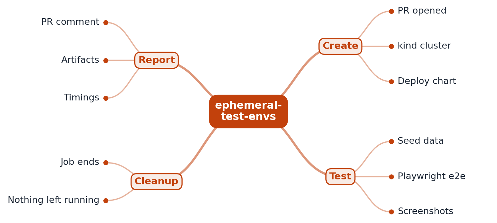

# ephemeral-test-envs

[](https://github.com/EquinoxWN/ephemeral-test-envs/actions/workflows/ci.yml)
[](https://github.com/EquinoxWN/ephemeral-test-envs/actions/workflows/ephemeral-env.yml)


> Catches integration bugs before merge: every pull request spins up the whole system, tests it, and tears it down, with no server to run.

Part of my **DevOps and Cloud** list · Go · YAML

## Proof it works

`etenv` turns production-shaped data into seed data with keyed pseudonyms, generalized fields and
groups of at least 5 customers, then scans the result for any raw value. 250 synthetic customers
became 247 (3 suppressed to meet the group rule) and the leak scan is clean. The rendered Helm
chart passes the safety policy with 0 violations, and the per-PR plan builds every command from
validated values:



39 Go tests pass, `helm lint --strict` and the chart policy are clean, and govulncheck finds no
vulnerabilities:



The kind run itself (cluster, images, chart, `helm test`, teardown) runs in the `ephemeral-env`
workflow on GitHub. Its first run (2026-10-18) passed: environment up in 79 s, 80 s in total,
cluster torn down. It was not run on the development machine (see
[Tests and results](#tests-and-results)).

## Architecture

**What M1 runs today:**



**Full roadmap (M1 to M3):**



## How it works

_Steps 1 and 2 are built and tested (M1); the rest is on the [roadmap](#roadmap)._

1. When a PR opens, the CI job starts a kind cluster: a real Kubernetes cluster running in Docker on the CI runner.
2. It builds the PR's images, loads them into kind and installs the app's Helm chart with anonymized seed data.
3. Playwright runs end-to-end tests against the whole system, capturing screenshots and traces.
4. Results, screenshots and timings are posted as a PR comment and stored as build artifacts.
5. Caching of images and Helm dependencies keeps the full run short.
6. When the job ends the runner is discarded, so nothing is left running or billed.

In M1, `etenv up` runs eight steps (create cluster, build two images, load them, install the chart,
`helm test`, list resources), collects events and logs if a step fails, and always deletes the
cluster. The chart's post-install Job loads the seed; Helm fails the install if the Job fails. The
`helm test` pod checks that the service holds exactly the seed: same counts, same SHA-256 of the
canonical data, and one customer read back field by field.

## Who it helps

- **Who:** teams that ship a service as container images and a Helm chart, and the platform
  engineers who own their CI.
- **The problem:** integration bugs (a chart value that does not match the code, a pod that cannot
  start as non-root, seed data the service refuses) show up in a shared staging cluster after
  merge, and staging often holds copies of personal data.
- **What M1 does:** every pull request gets its own kind cluster on the CI runner with its own
  images and anonymized seed data, checked by `helm test` and deleted afterwards. The anonymizer
  keeps links between tables, generalizes quasi-identifiers, enforces groups of at least k and
  scans for leaks; the service refuses data in any other shape.
- **How to use it:** copy `deploy/chart`, `Dockerfile` and `.github/workflows/ephemeral-env.yml`,
  point the chart at your images, write field rules for your schema in `internal/anon`, and run
  `make seed` with your key from a secret store.

## Tech stack

| Area | In M1 | Planned |
|---|---|---|
| Cluster | kind v0.33.0, node `kindest/node:v1.37.0` pinned by digest, one control-plane node, API server on loopback | Image and Helm caching (M3) |
| Deploy | Helm v4.3.0 chart with `values.schema.json`, post-install seed Job, `helm test` pod, NetworkPolicy | |
| Images | Multi-stage Dockerfile, `golang:1.26.9-alpine` and `distroless/static:nonroot` by digest, static stripped binaries | |
| Seed data | Go anonymizer: HMAC-SHA256 pseudonyms, generalization, k-group suppression, leak scan | |
| Orchestration | `etenv` CLI (Go 1.26): argv plan, no shell, own kubeconfig, report JSON, GitHub annotations | Playwright tests, PR comment and artifacts (M2) |
| Quality | gofmt, go vet, helm lint, chart policy, Go tests with the race detector in CI, govulncheck | |

| Path | What it is |
|---|---|
| `cmd/etenv` | CLI: `synth`, `anonymize`, `scan`, `policy`, `plan`, `up`, `down` |
| `cmd/api`, `cmd/seeder` | The sample orders service and the seed loader/verifier (two image targets) |
| `internal/anon` | Pseudonyms, generalization, k-groups, leak scan |
| `internal/dataset` | Raw and seed shapes, strict decoding, validation, checksum |
| `internal/envplan` | Command plan, runner with diagnostics and guaranteed teardown, report |
| `internal/chartpolicy` | Safety rules for rendered manifests |
| `deploy/chart`, `deploy/kind` | Helm chart (with `files/seed.json`) and kind cluster config |
| `testdata/raw.json` | Synthetic production-shaped data (fake people only) |
| `scripts/get-tools.sh` | Pinned kind, Helm and kubectl downloads with SHA-256 checks |

## Run it

Needs Go 1.26+, make, and bash with curl (Git Bash on Windows). Docker is needed only for the full
environment run. Downloads and caches stay in `.tmp/` inside the repository.

```bash
make setup        # Go modules and Helm v4.3.0 (checksum-verified) into .tmp/bin
make lint         # gofmt, go vet, helm lint --strict
make test         # Go tests
make chart-check  # leak scan of the seed, helm template | etenv policy
make audit        # govulncheck v1.8.0
make seed         # regenerate testdata/raw.json and the chart's seed.json
make tools        # kind, Helm, kubectl (Linux) into .tmp/bin
make env PR=1 COMMIT=$(git rev-parse HEAD)   # create, seed, test and delete a kind environment
```

Or step by step:

```bash
.tmp/bin/etenv synth -customers 250 -seed 1 -out .tmp/raw.json
ETENV_ANON_KEY=<secret of at least 32 bytes> .tmp/bin/etenv anonymize -in .tmp/raw.json -out .tmp/seed.json -k 5
.tmp/bin/etenv scan -raw .tmp/raw.json -seed .tmp/seed.json
.tmp/bin/etenv plan -pr 42 -commit 0123456   # print the commands without running them
.tmp/bin/etenv down -pr 42                   # delete a cluster left by an interrupted run
```

## Tests and results

Latest local run (full detail in [docs/results/m1.md](docs/results/m1.md)):

| Test file | Tests | What it proves |
|---|---|---|
| `internal/dataset/dataset_test.go` | 5 | Strict decoding refuses the raw shape, trailing data and input over 4 MiB; 18 kinds of personal or broken rows refused; checksum ignores row order, not content |
| `internal/anon/anon_test.go` | 10 | Deterministic per key; links and date spacing survive; groups of at least k for k = 2, 5, 10; 0 leaks over 25 generated datasets; 8 injected leaks all caught; committed seed reproduced byte for byte |
| `internal/synth/synth_test.go` | 2 | Deterministic synthetic data; size limits |
| `internal/api/api_test.go` | 4 | Load and read back; raw data 400, personal-looking data 422, oversize 400, refused loads change nothing; probes and headers; concurrent reloads and reads |
| `internal/seeder/seeder_test.go` | 4 | The chart's seed loaded into the real API handler and verified end to end; a one-cent difference fails; 5xx retried, 4xx not; bounded attempts; bad URLs refused |
| `internal/envplan/envplan_test.go` | 9 | 10 unsafe configs refused; step order; own kubeconfig on every helm and kubectl call; teardown after success, failure and cancellation; failed teardown reported; real child process run |
| `internal/chartpolicy/chartpolicy_test.go` | 5 | Good manifests pass; 16 mutations each caught by their rule; digest-pinned images allowed; Jobs and Pods checked; broken YAML refused |

| Check | Result |
|---|---|
| Tests | 39 passed, 0 failed (Go 1.26.9; CI adds the race detector) |
| Lint | gofmt and go vet clean; `helm lint --strict` 0 failed |
| Chart policy | 6 objects, 3 containers, 0 violations; schema refuses `image.tag=latest` and `pullPolicy=Always` |
| Seed | 250 -> 247 customers, 600 -> 597 orders, smallest group 5 (k=5), leak scan clean |
| Audit | govulncheck v1.8.0: no vulnerabilities |
| kind run (create, build, load, install, `helm test`, delete) | CI, passed on 2026-10-18: `etenv-pr-1` up in 79 s, total 80 s, torn down (not run locally) |

The full local check passed twice.

## Roadmap

**M1** (≈8 h)
- [x] Write `docs/rfc/0001-design.md`: problem, goals, non-goals, chosen design
- [x] When a PR opens, the CI job starts a kind cluster: a real Kubernetes cluster running in Docker on the CI runner.
- [x] It builds the PR's images, loads them into kind and installs the app's Helm chart with anonymized seed data.

**M2** (≈8 h)
- [ ] Playwright runs end-to-end tests against the whole system, capturing screenshots and traces.
- [ ] Results, screenshots and timings are posted as a PR comment and stored as build artifacts.

**M3** (≈9 h)
- [ ] Caching of images and Helm dependencies keeps the full run short.
- [ ] When the job ends the runner is discarded, so nothing is left running or billed.
- [ ] Publish the proof below with real numbers

## Proof

What this repo must show before it counts as done:

- Total PR pipeline time before vs after caching, and a PR comment showing a caught regression.

| Result | Value |
|---|---|
| Pipeline time before vs after caching | Not measured yet (M3). M1 prints each run's step timings in CI. |
| PR comment with a caught regression | Not built yet (M2). |

## Why it matters

- **Interview angle:** 'Make CI catch integration bugs before merge'.
- **Upstream I'd like to contribute to:** kind (Kubernetes SIG) or Playwright.

## Design docs

- [RFC 0001: design](docs/rfc/0001-design.md)
- [ADR 0001: record architecture decisions](docs/adr/0001-record-architecture-decisions.md)
- [ADR 0002: a kind cluster per pull request on the CI runner](docs/adr/0002-kind-cluster-per-pull-request.md)
- [ADR 0003: keyed pseudonyms, generalization and k-groups for seed data](docs/adr/0003-keyed-pseudonyms-and-k-groups.md)
- [M1 results](docs/results/m1.md)

## Scope

This is a learning and portfolio system, not a hosted production service. The sample service keeps
its data in memory, the fixtures are synthetic, and the committed key only anonymizes those
fixtures. Environments live only as long as one CI job.

## Security and contributing

- Commands are argv lists built from validated values and run without a shell; each environment
  uses its own kubeconfig inside the repository, and teardown always runs.
- Pods run as non-root with a read-only root filesystem, no capabilities, no service account token,
  the default seccomp profile and resource limits; a NetworkPolicy isolates the API.
- Base images, the kind node image, kind, Helm and kubectl are pinned by digest or SHA-256; every
  GitHub Action is pinned to a commit SHA; workflows run read-only, without persisted credentials.
- Dependabot update pull requests are paused (`open-pull-requests-limit: 0`) so the repository keeps a single `main` branch; dependencies are updated by hand and checked by the CI audit.
- Report vulnerabilities privately: see [SECURITY.md](SECURITY.md). To contribute, see [CONTRIBUTING.md](CONTRIBUTING.md).

## License

MIT, see [LICENSE](LICENSE).
